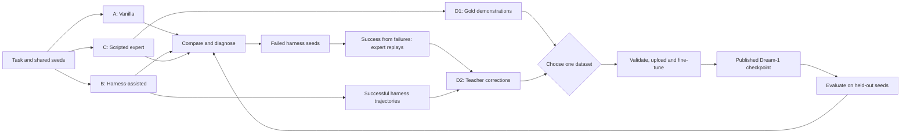

# DreamLoop

### Every experiment. A little more capable.

**The evaluation, failure-analysis and fine-tuning studio for Dream-1 in DreamLab.**

DreamLoop turns a robot's failed task into a concrete next step: an execution setting to change, a harness module to enable, or an expert demonstration to train on.

Built for the **Dream Labs track at HackLab Berlin × BRISA**, it connects repeatable simulation, physics-grounded diagnosis, targeted data collection and real API fine-tuning in one developer workspace.

> Run it. Find the failure. Teach the fix. Measure again.

## The problem we solve

A successful robot demo does not tell a developer how reliably a task works, why it fails on a different start, or which demonstrations would help.

That evidence is usually scattered across simulator recordings, configuration files, model calls and training scripts. A missed grasp, a bad placement and a dropped connection can all end with the same unhelpful label: failed.

DreamLoop brings the evidence and the next action into the same workflow.

## One studio, from first run to next checkpoint

| Workspace | What a developer can do |
| --- | --- |
| **Overview** | Understand the product, explore the experiment modes and inspect the shippable harness. |
| **Experiments** | Configure simulations, monitor live trial progress, inspect results and replay individual trials. |
| **Analyze Jobs** | Compare up to three save files, inspect configuration differences and trace failures. |
| **Fine-tuning** | Choose a training dataset, launch a real Dream Labs job, track its progress and test the returned model. |
| **Methodology** | Explore the end-to-end architecture through an expandable flowchart. |

The interface follows Dream Labs' visual language: Walla typography, warm peach and sunshine accents, pastel graphics and locally bundled brand assets. Fixed navigation keeps the workspace accessible while the main content scrolls.

## 1. Run repeatable experiments

Define a scene, an instruction, a target object and a graded goal. Set seeds, repeated trials, object-position jitter, simulation time, action rows per reply and an estimated API cost cap.

For multi-step tasks, Dream-1 receives one combined instruction while the simulator grades the steps in order. Keep starting conditions aligned when comparing configurations.

### Three experiment modes

| Mode | How it runs | What it tells you |
| --- | --- | --- |
| **A · Vanilla baseline** | Dream-1 controls the robot without harness modules. | What the model can do unassisted. |
| **B · Harness-assisted** | Dream-1 runs with your selected assistance modules and settings. | Which interventions help and which failures remain. |
| **C · Scripted / oracle** | An expert controller uses simulator state and inverse kinematics, without Dream-1 inference. | What a successful trajectory looks like and which demonstrations are available. |

Monitor the active seed, trial and progress. Search and filter experiments, inspect their requests and responses, download save files, cancel running work, and retain configuration and model identity alongside the results.

## 2. Ship the harness with your own workflow

**DreamLoop includes `dream-harness`, a standalone Python library distributed as an installable wheel.** The studio and evaluation engine use the same package, so the capabilities demonstrated in the UI can also be integrated into a developer's simulator workflow.

Pick individual modules for the pick-and-place behavior you want to improve:

| Module | Capability |
| --- | --- |
| **Reconnect** | Retries expired sessions, dropped connections and a full model pool. |
| **Clamp gripper** | Clips small gripper overshoots instead of rejecting the reply. |
| **Wrong-object watch** | Returns home and re-prompts after a non-target grab. |
| **Grasp retry** | Returns home and re-prompts after a stalled grasp or a dropped object. |
| **Grasp depth** | Attempts a lower regrasp when the gripper closes above the object. |
| **Edge pinch** | Regrasps when the fingers pinch an edge rather than the object's faces. |
| **Backtrack** | Replays recent commanded motion in reverse after a stalled grasp. |
| **Place assist** | Centers the carried object over its goal before release. |
| **Adaptive chunking** | Executes fewer action rows per reply near the object. |

Tune replay buffers, forecast rows, grasp tolerances, retry limits, placement timing and connection handling per run.

**Assistance stays visible.** All modules except Reconnect and Clamp gripper use simulator ground truth to steer behavior. Those runs are marked as steered, keeping assisted outcomes distinguishable from the vanilla model baseline.

## 3. Explain what went wrong

Load up to **three experiment save files** from the server or disk and compare them side by side.

- **Configuration:** model, task, seed coverage, trial count, time limits, action chunk size and harness overrides.
- **Performance:** success counts, confidence intervals, per-seed outcomes, calls, latency and estimated costs.
- **Trajectory:** contact, lift, carry and goal-settlement milestones, with an ordered intervention log.
- **Replay:** inspect recorded camera views and expand available GIF or video playback for a closer look.
- **Concrete failure reasons:** see the failed step, relevant timing, lift measurements or goal distance when recorded, and the actual exception for infrastructure errors.

Failures are separated into approach, grasp, placement and task-logic problems. Connection and simulator errors remain distinguishable from policy failures.

The goal is a specific decision after each run: adjust a setting, enable a module, or collect the expert trajectory for a difficult starting condition.

## 4. Turn failed starts into successful demonstrations

The **Success from failures** controller closes the gap between diagnosis and data collection.

Choose a finished harness experiment. DreamLoop identifies the seeds where it failed, excludes infrastructure errors, and runs the scripted expert again with the same task, scene, jitter and time limit. The new experiment retains a link to its source.

Its successful runs become teacher corrections for those difficult starts. The original harness experiment's successful trials remain available as additional training examples.

These are expert replays **from the same initial conditions**, rather than recovery clips restored from a mid-run failure state. The failure selects the case; a successful trajectory supplies the behavior to learn.

## 5. Choose the training strategy that fits the question

The fine-tune builder offers two dataset strategies. **Choose one for each job** so demonstration-only training and failure-aware training can be evaluated separately.

| Strategy | Training examples | Purpose |
| --- | --- | --- |
| **Dataset 1 · Gold standard** | Complete, successful scripted sessions. | Teach the full task from beginning to end. |
| **Dataset 2 · Failure corrections + harness successes** | Successful teacher replays from a Success from failures experiment, plus successful trials from its linked harness experiment. | Target difficult starts while retaining behavior the harness already completed successfully. |

Preview the selected trajectories, their sources, episode counts, frame counts and composition before submitting. Unsuccessful teacher replays are left out.

Real training requires complete recorded episodes. The backend checks that selected trajectories have usable recordings and aligned frame counts; importing a result JSON alone does not create trainable camera and action data.

Reserve separate seeds for evaluation when selecting training data. Dataset preparation is a decision the developer can inspect, rather than an invisible side effect.

## 6. Fine-tune through the real Dream Labs API

Fine-tuning in the current console is a **live integration**. After the developer confirms the provider charge, DreamLoop:

1. Builds a LeRobot dataset from the selected successful recordings.
2. Validates the dataset locally.
3. Uploads it and waits for Dream Labs processing.
4. Submits a Dream-1 fine-tuning job.
5. Tracks queue position, training progress and the published checkpoint.
6. Makes the completed model available for a new experiment.

Local job state retains dataset and job identifiers. The worker retries transient failures and checks for existing uploads or submissions when resuming.

The dedicated **Fine-tuning** page shows local jobs and jobs discovered on the connected Dream Labs account. Completed models carry fine-tuned labels, and **Test model in a new experiment** takes the returned checkpoint directly back into the run workflow.

### Keep spending understandable

The studio shows estimated inference costs, fine-tuning charges, funds held for active training jobs and available queue information. An optional `DREAM_FINETUNE_BUDGET_USD` setting adds a remaining-budget view.

These totals describe job charges and the configured budget. They are not a live account-credit balance: the service does not expose a balance endpoint.

## The complete improvement loop



## Why DreamLoop stands out

**It connects evidence to action.** The same failed seed can be inspected, replayed by an expert, selected for training and revisited in the next model comparison.

**It makes assistance reusable.** Nine selectable harness modules ship as a Python package, alongside the studio that exposes and evaluates them.

**It keeps the experiment interpretable.** Model identity, seed coverage, settings, steering, failure reasons and training sources remain inspectable.

**It closes the product loop.** Experiment execution, failure analysis, correction collection, real fine-tuning and checkpoint re-evaluation are available in the same workflow.

The repository also contains earlier simulator studies on action chunking, pick-and-place tasks, stacking, task ordering and bimanual coordination. They motivate the workflow; they do not establish a universal success rate or a measured gain for every new checkpoint.

## A judge's walkthrough

1. **Create a baseline and a harness experiment** on the same task and seeds.
2. **Open a failed trial** to inspect its reason, milestones, interventions and camera replay.
3. **Compare save files in Analyze Jobs** to connect configuration differences with outcomes.
4. **Create Success from failures** from the harness run to collect expert demonstrations on failed seeds.
5. **Open Fine-tuning**, choose Dataset 1 or Dataset 2, and inspect exactly which trajectories would train the model.
6. **Review a completed job and test its checkpoint** on held-out seeds.

Live inference and training use configured Dream Labs access and may incur provider charges. Training completion depends on the service; use an existing completed job when presenting the full loop.

## Run locally

### Open the built studio

From the repository root:

```powershell
python -m mission_control --port 8765
```

Open **http://127.0.0.1:8765/**. The repository includes the built frontend; Node is only needed when rebuilding the UI.

### Set up simulation

Use Python 3.13 and the repository's simulation dependencies:

```powershell
python -m pip install -r mission_control/requirements-sim.txt
python -m mission_control.execution --probe stock
```

The requirements include the bundled `dream-harness` wheel. Scripted experiments do not call the Dream-1 inference API. Live model runs and fine-tuning need configured Dream Labs credentials and account access. Start with `--prompt-key` to enter an existing API key without echoing or saving it.

Recorded-episode export and validation also require the Dream Labs client's dataset dependencies. See [execution and datasets](mission_control/EXECUTION.md) for setup details, and use the current Fine-tuning page for live job controls.

### Rebuild the frontend

```powershell
cd mission_control/frontend
npm.cmd ci
npm.cmd run build
```

The build writes to `mission_control/web/app`, which the Python server serves directly.

## Under the hood

| Layer | Technology |
| --- | --- |
| Studio | React, TypeScript, Vite, Tailwind CSS, shadcn/ui, Radix and Recharts |
| Application and orchestration | Python, local experiment records, job workers and recorded media |
| Simulation and grading | Dream YAM / MuJoCo with physics-state outcome detectors |
| Reusable assistance | Standalone `dream-harness` Python wheel |
| Training | Dream Labs SDK, LeRobot dataset export and validation, live fine-tuning and checkpoint discovery |

## Explore the implementation

- [Standalone harness: installation, configuration and modules](harness/README.md)
- [Frontend: local development and design system](mission_control/frontend/README.md)
- [Execution, recordings and datasets](mission_control/EXECUTION.md)
- [Historical phase results](PHASE_RESULTS.md)
- [Evaluation engine and recorded studies](dreameval/)

**DreamLoop — turn every run into a better next experiment.**
